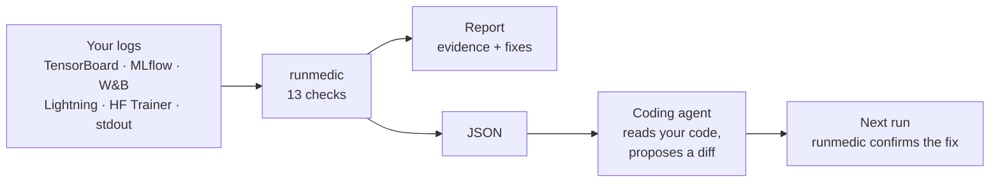

<div align="center">

# 🩺 runmedic

### A doctor for your training runs

Point it at your logs. Get a diagnosis with evidence and the fix to try.

[](https://pypi.org/project/runmedic/)
[](https://github.com/vincere-mori/runmedic/actions/workflows/ci.yml)


**English** · [Русский](https://github.com/vincere-mori/runmedic/blob/main/README.ru.md)


<sub>A real PyTorch run with a broken LR schedule. runmedic finds the NaN, the gradient blow-up before it, and the schedule that caused it.</sub>

</div>

## Why

Loss went NaN overnight. Val loss has been creeping up for two days. The GPU sits at 40%. All the curves are in TensorBoard or W&B, but reading them still takes experience and time.

runmedic reads the same logs and tells you:

- 🔎 **what is wrong**, with the step where it started
- 📊 **why it thinks so**, with the numbers from your run
- 🛠️ **what to change**, as concrete code-level fixes

It also ships as a **skill for coding agents** (Claude Code, Codex and others), so the agent can run the diagnosis, open your training code, find the line responsible and propose a fix.

## Quick start

```bash
pip install runmedic
runmedic diagnose runs/        # a log dir, a file, mlflow.db or a W&B run URL
```

No install needed with uv: `uvx runmedic diagnose runs/`

## How it works



## What it catches

| | Problem | Example of what you get |
|:-:|---|---|
| 💥 | **NaN / inf** | step where it broke, what led up to it: loss climb, gradient blow-up, an LR that kept rising, or a bug from step 0 |
| 📈 | **Divergence** | loss went down and came back, how much progress was lost, where to resume |
| 🧊 | **Not learning** | flat loss, LR = 0, loss ≈ ln(k) meaning the model predicts uniformly over k classes |
| ⚡ | **Loss and gradient spikes** | the exact steps to inspect, a clipping threshold that fits your run, missing warmup |
| 🎯 | **Overfitting** | best checkpoint step and how far val has moved since |
| 🪞 | **Val below train** | usually fine, sometimes a train/val leak, and how to tell |
| 📉 | **Plateau with constant LR** | when a decay schedule would still help |
| 🐢 | **Waiting on data** | idle GPU or most of the step spent in the DataLoader |
| ⏱️ | **Slow steps and slowdowns** | including periodic ones, like a checkpoint saved inside the loop |
| 🧠 | **Memory growth** | GPU or host memory creeping up, and the usual leak patterns behind it |
| 🧾 | **Known crashes in stdout** | CUDA OOM, DataLoader killed / shm, AMP overflow, NCCL timeout and more |

A healthy run gets a short "No problems found". The thresholds are tuned to stay quiet unless something is clearly off.

<details>
<summary><b>More examples</b></summary>

<br>

Overfitting on a tiny noisy dataset:


A slow `__getitem__` and a checkpoint saved every 50 steps:


All four demo runs are in [`examples/logs`](https://github.com/vincere-mori/runmedic/tree/main/examples/logs), produced by [`examples/broken_training.py`](https://github.com/vincere-mori/runmedic/blob/main/examples/broken_training.py).

</details>

## Supported logs

| Source | What to pass |
|---|---|
| TensorBoard | log dir or `events.out.tfevents*` file. Own parser, no TensorFlow needed |
| MLflow | `mlflow.db` (default since MLflow 3) or `mlruns/` |
| Weights & Biases | run URL or `wandb:entity/project/run_id`. Needs `pip install "runmedic[wandb]"` |
| PyTorch Lightning | `lightning_logs/version_N/` or its `metrics.csv` |
| HF Transformers | the Trainer `output_dir` |
| CSV / JSON Lines | any table with a step column |
| stdout | `step 100 loss=0.52`, HF Trainer dicts, nanoGPT style, Lightning progress bars |

Metric names are recognized automatically. `runmedic series PATH` shows how they were read, `--train-loss NAME` and friends override it.

## Commands

```bash
runmedic diagnose runs/exp1                      # readable report
runmedic diagnose runs/ --json                   # for agents and scripts
runmedic diagnose mlflow.db --run my-run         # pick runs by name
runmedic diagnose train.log --fail-on critical   # exit code 1 for CI
runmedic series runs/exp1                        # what was found and how it was read
```

## Agent skill

Send this to your agent and it installs everything:

```
Install the runmedic skill following these instructions: https://raw.githubusercontent.com/vincere-mori/runmedic/main/INSTALL.md
```

Then ask it things like *"why did my training blow up?"* or *"why is the GPU at 40%?"*. The skill walks the agent through the whole loop: find the logs, diagnose, read the code, explain the cause, propose a minimal diff, verify on the next run. It comes with a [playbook](https://github.com/vincere-mori/runmedic/blob/main/plugins/runmedic/skills/runmedic/references/playbook.md) of fixes per problem.

<details>
<summary>Manual install</summary>

**Claude Code**

```
/plugin marketplace add vincere-mori/runmedic
/plugin install runmedic@runmedic
```

**Codex and other agents with `SKILL.md` support**

```bash
git clone --depth 1 https://github.com/vincere-mori/runmedic.git
mkdir -p ~/.agents/skills && cp -r runmedic/plugins/runmedic/skills/runmedic ~/.agents/skills/
```

</details>

## Under the hood

<details>
<summary>How the diagnosis is made</summary>

<br>

1. **Load.** One small reader per logger. TensorBoard event files are decoded directly (TFRecord framing plus a minimal protobuf decoder for scalars). MLflow is read from its sqlite database or file store, W&B through the public API.
2. **Interpret.** Series names are mapped to roles: train loss, val loss, LR, grad norm, GPU utilization, memory, step and data time, throughput.
3. **Check.** Each check is a small heuristic over smoothed curves and robust statistics (EMA, median/MAD z-scores, rank correlation) that looks for one failure mode and collects evidence.
4. **Explain.** Every finding has evidence, likely causes ordered by how well the data supports them, and fixes.

There is no model inside: it is fast, deterministic and works offline.

</details>

<details>
<summary>Limitations</summary>

<br>

- It reads curves, not code. Confirming the cause in the code is what the agent skill is for.
- It can only see what you log. Without grad norm or LR the NaN report is less specific, without step and data time an input bottleneck is invisible. The playbook has a logging snippet that covers everything.
- W&B offline runs are not read directly yet: sync them or export the history to CSV.

</details>

<details>
<summary>Related work</summary>

<br>

AutoTrainer (ICSE 2021) and TrainCheck (OSDI 2025) detect training problems by instrumenting the training process itself. runmedic works after the fact on the logs you already have, across loggers, and hands its findings to a coding agent that can fix the code.

</details>

## Contributing

The most useful thing you can send is a run that runmedic got wrong: open an issue with the logs (or a CSV of the metrics) and what the real problem was. New checks and log formats are welcome too. Each check needs a test with a curve that triggers it and one that must stay quiet.

```bash
pip install -e . pytest tensorboard ruff
pytest && ruff check src tests examples && ruff format --check src tests examples
```

## License

MIT
