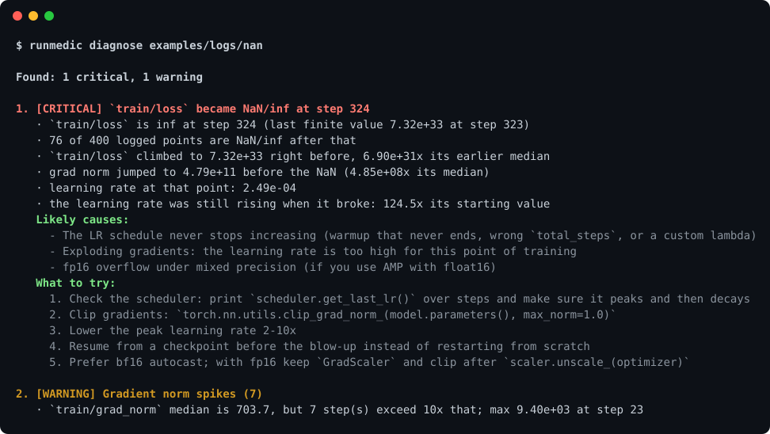
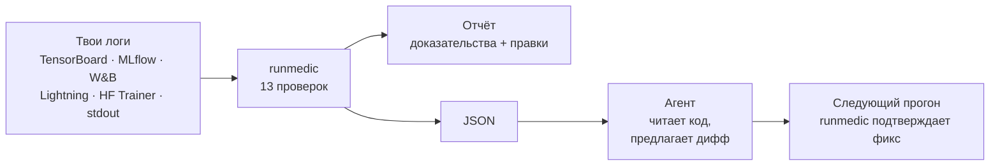
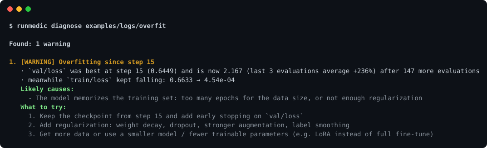
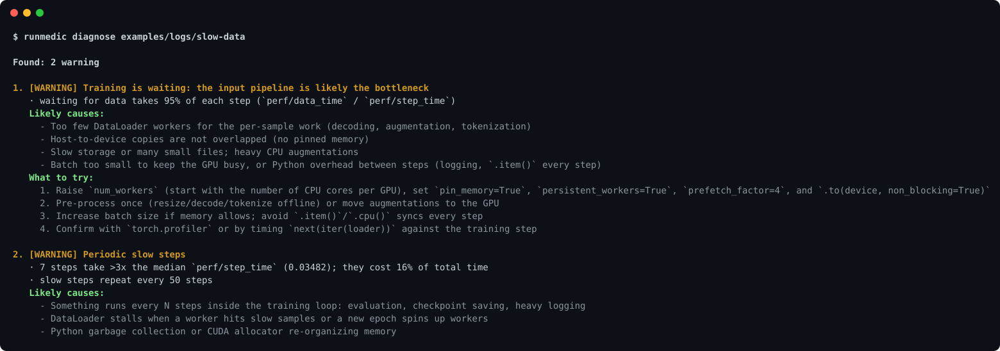

<div align="center">

# 🩺 runmedic

### Доктор для обучения моделей

Даёшь ему логи, получаешь диагноз с доказательствами и правку, которую стоит попробовать.

[](https://pypi.org/project/runmedic/)
[](https://github.com/vincere-mori/runmedic/actions/workflows/ci.yml)


[English](README.md) · **Русский**



<sub>Настоящее обучение на PyTorch со сломанным расписанием LR. runmedic находит NaN, взрыв градиентов перед ним и расписание, из-за которого всё случилось.</sub>

</div>

## Зачем

Лосс ушёл в NaN ночью. Val loss второй день ползёт вверх. GPU загружена на 40%. Все кривые лежат в TensorBoard или W&B, но чтобы их прочитать, нужны опыт и время.

runmedic читает те же логи и говорит:

- 🔎 **что сломалось** и на каком шаге началось
- 📊 **почему он так решил**, с цифрами из твоего прогона
- 🛠️ **что поменять**, конкретными правками в коде

Ещё это **скилл для AI-агентов** (Claude Code, Codex и другие): агент сам запускает диагностику, открывает код обучения, находит виноватую строку и предлагает исправление.

## Быстрый старт

```bash
pip install runmedic
runmedic diagnose runs/        # папка с логами, файл, mlflow.db или ссылка на ран W&B
```

С uv можно без установки: `uvx runmedic diagnose runs/`

## Как это работает



## Что ловит

| | Проблема | Что получишь |
|:-:|---|---|
| 💥 | **NaN / inf** | шаг, где сломалось, и что этому предшествовало: рост лосса, взрыв градиентов, LR, который всё рос, или баг с первого шага |
| 📈 | **Расхождение** | лосс снижался и вернулся обратно; сколько прогресса потеряно и откуда продолжить |
| 🧊 | **Модель не учится** | плоский лосс, LR = 0, loss ≈ ln(k), то есть модель предсказывает равномерно по k классам |
| ⚡ | **Скачки лосса и градиентов** | точные шаги, которые стоит посмотреть, порог клиппинга под твой прогон, отсутствие warmup |
| 🎯 | **Переобучение** | шаг лучшего чекпойнта и насколько val ушёл с тех пор |
| 🪞 | **Val ниже train** | обычно нормально, иногда утечка между train и val, и как это проверить |
| 📉 | **Плато при постоянном LR** | когда затухание LR ещё помогло бы |
| 🐢 | **Ожидание данных** | GPU простаивает или большая часть шага уходит на DataLoader |
| ⏱️ | **Медленные шаги и замедление** | в том числе периодические, например чекпойнт внутри цикла |
| 🧠 | **Рост памяти** | память GPU или хоста ползёт вверх, и типичные утечки, которые за этим стоят |
| 🧾 | **Известные падения в stdout** | CUDA OOM, убитый воркер DataLoader / shm, переполнение AMP, таймаут NCCL и другие |

Для здорового прогона будет короткое «No problems found». Пороги подобраны так, чтобы молчать, пока что-то явно не так.

<details>
<summary><b>Ещё примеры</b></summary>

<br>

Переобучение на маленьком шумном датасете:



Медленный `__getitem__` и чекпойнт каждые 50 шагов:



Все четыре демо-прогона лежат в [`examples/logs`](examples/logs), их делает [`examples/broken_training.py`](examples/broken_training.py).

</details>

## Какие логи понимает

| Источник | Что передать |
|---|---|
| TensorBoard | папку с логами или файл `events.out.tfevents*`. Свой парсер, TensorFlow не нужен |
| MLflow | `mlflow.db` (по умолчанию с MLflow 3) или `mlruns/` |
| Weights & Biases | ссылку на ран или `wandb:entity/project/run_id`. Нужен `pip install "runmedic[wandb]"` |
| PyTorch Lightning | `lightning_logs/version_N/` или его `metrics.csv` |
| HF Transformers | `output_dir` Trainer'а |
| CSV / JSON Lines | любую таблицу со столбцом шага |
| stdout | `step 100 loss=0.52`, словари HF Trainer, формат nanoGPT, прогресс-бары Lightning |

Имена метрик распознаются автоматически. `runmedic series PATH` покажет, как они прочитаны, а `--train-loss NAME` и похожие флаги позволяют поправить.

## Команды

```bash
runmedic diagnose runs/exp1                      # отчёт для человека
runmedic diagnose runs/ --json                   # для агентов и скриптов
runmedic diagnose mlflow.db --run my-run         # выбрать раны по имени
runmedic diagnose train.log --fail-on critical   # код выхода 1 для CI
runmedic series runs/exp1                        # что найдено и как прочитано
```

## Скилл для агентов

Отправь агенту, и он всё установит сам:

```
Установи скилл runmedic по инструкции: https://raw.githubusercontent.com/vincere-mori/runmedic/main/INSTALL.md
```

Дальше спрашивай: *«почему взорвалось обучение?»*, *«почему GPU загружена на 40%?»*. Скилл ведёт агента по всему циклу: найти логи, поставить диагноз, прочитать код, объяснить причину, предложить минимальный дифф, проверить на следующем прогоне. В комплекте [плейбук](plugins/runmedic/skills/runmedic/references/playbook.md) с правками для каждой проблемы.

<details>
<summary>Установить вручную</summary>

**Claude Code**

```
/plugin marketplace add vincere-mori/runmedic
/plugin install runmedic@runmedic
```

**Codex и другие агенты с поддержкой `SKILL.md`**

```bash
git clone --depth 1 https://github.com/vincere-mori/runmedic.git
mkdir -p ~/.agents/skills && cp -r runmedic/plugins/runmedic/skills/runmedic ~/.agents/skills/
```

</details>

## Под капотом

<details>
<summary>Как ставится диагноз</summary>

<br>

1. **Загрузка.** Для каждого логгера свой маленький ридер. Файлы TensorBoard разбираются напрямую (формат TFRecord и минимальный декодер protobuf для скаляров). MLflow читается из sqlite-базы или файлового хранилища, W&B через публичный API.
2. **Интерпретация.** Имена рядов сопоставляются с ролями: train loss, val loss, LR, норма градиента, загрузка GPU, память, время шага и данных, throughput.
3. **Проверки.** Каждая проверка это небольшая эвристика над сглаженными кривыми и робастной статистикой (EMA, z-оценки по медиане и MAD, ранговая корреляция). Она ищет одну проблему и собирает доказательства.
4. **Объяснение.** У каждой находки есть доказательства, вероятные причины в порядке того, насколько их поддерживают данные, и правки.

Внутри нет модели: всё быстро, детерминированно и работает офлайн.

</details>

<details>
<summary>Ограничения</summary>

<br>

- runmedic читает кривые, а не код. Подтвердить причину в коде помогает скилл для агентов.
- Он видит только то, что логируется. Без нормы градиента и LR отчёт про NaN менее конкретный, без времени шага и данных не видно узкого места в загрузке. В плейбуке есть сниппет, который логирует всё нужное.
- Офлайн-раны W&B пока не читаются напрямую: синхронизируй их или выгрузи историю в CSV.

</details>

<details>
<summary>Похожие работы</summary>

<br>

AutoTrainer (ICSE 2021) и TrainCheck (OSDI 2025) ищут проблемы, встраиваясь в сам процесс обучения. runmedic работает постфактум по логам, которые у тебя уже есть, с любым популярным логгером, и передаёт находки агенту, который может починить код.

</details>

## Как помочь

Самое полезное это прогон, который runmedic продиагностировал неправильно: открой issue с логами (или CSV с метриками) и тем, что было на самом деле. Новые проверки и форматы логов тоже приветствуются. Для каждой проверки нужен тест с кривой, на которой она срабатывает, и с кривой, на которой должна молчать.

```bash
pip install -e . pytest tensorboard ruff
pytest && ruff check src tests examples && ruff format --check src tests examples
```

## Лицензия

MIT
